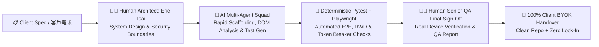

# Hi there, I'm Eric Tsai (`EricTsaiQA`) 👋
### Senior QA Automation Architect & Full-Stack / AI Indie Developer
**資深 QA 自動化測試架構師 ＆ 全端 / AI 獨立開發者（e3t4fun Studio）**

---

## 🤖 Half-Human, Half-AI Collaborative Studio｜一半真人、一半 AI 的協作團隊｜人間とAIの協働スタジオ

> **Honesty First (誠實為上策):** We openly operate as a **Half-Human, Half-AI Collaborative Engineering Studio (`e3t4fun Studio`)**. We believe transparency builds the strongest engineering trust.
>
> 我們坦誠且自豪地採用 **「一半真人、一半 AI」的混合協作模式（Half-Human, Half-AI Collaborative Studio）**。這讓我們的客戶同時享有**「資深工程師的架構把關與真人驗收責任」**以及**「AI 多代理團隊的極速開發與高覆蓋率測試產能」**：

| Dimension / 維度 | 👨‍💻 Human Lead (Eric Tsai — Senior QA & Full-Stack Architect) | 🤖 AI Multi-Agent Squad (24/7 Specialized Subagents) |
| :--- | :--- | :--- |
| **Core Role / 核心職責** | System Architecture, Security & Edge-Case Review, Real-Device QA Sign-Off, Client Communication | Rapid Boilerplate Scaffolding, DOM/Schema Analysis, Automated Test Generation, Trilingual Docs (EN/ZH-TW/JA) |
| **Accountability / 品質把關** | **100% Human Accountable** — Every line of code & test report is reviewed, executed, and signed off by Eric | Executes deterministic `pytest` & Playwright regression suites with **Zero Hallucinated Pass Verdicts** |
| **Cost & Security / 成本與資安** | Enforces strict **100% Client BYOK (Bring Your Own Key)** & Daily Token Circuit Breakers | Compresses DOM snapshots by **-98% tokens** during discovery and emits **$0-token deterministic code** for production |
| **Client Benefit / 客戶價值** | Senior QA rigor prevents fragile production bugs and runaway cloud/API bills | **3–5x faster PoC & MVP turnaround** at transparent, indie-friendly budgets |

---

## 🚀 Shipped Commercial Products (Live Proof of Work / 已上線雙平台自有產品)

All products below are architected, tested, localized (EN / 繁體中文 / 日本語), and shipped to production by **e3t4fun Studio**:

| Product / 產品名稱 | Platform / 平台 | Core Engineering Stack / 技術亮點 | Live Portal / 連結 |
| :--- | :--- | :--- | :--- |
| **🏋️‍♂️ GymMayday** | iOS (SwiftUI) & Android (Jetpack Compose) | AI-assisted beginner fitness & gym equipment coach, offline-first workout logging, trilingual localization (EN/ZH-TW/JA), strict E2E QA regression coverage. | [🌐 e3t4fun.com/gymmayday](https://e3t4fun.com/gymmayday/) |
| **🃏 RookiePit** | iOS (SwiftUI) & Android (Jetpack Compose) | AI Vision camera scanner for Sports Cards & TCG, structured JSON identification gateway, multi-currency FX rate cache, and real-time market price tracking. | [🌐 e3t4fun.com/rookiepit](https://e3t4fun.com/rookiepit/) |

---

## 📌 Featured Pinned Showcase Repositories (三大核心接案黃金作品集)

We maintain three production-grade, 100% runnable open-source showcase repositories demonstrating our exact delivery standards across **QA Automation**, **Data Scraping/ETL**, and **AI Vision + Mobile Backends**:

| Showcase Repository | Target Consulting Track / 對應接案領域 | Key Verified Metrics & Engineering Highlights |
| :--- | :--- | :--- |
| **[1. `playwright-ai-qa-framework`](https://github.com/EricTsaiQA/playwright-ai-qa-framework)** | **QA Automation & Self-Healing E2E Testing** 自動化測試框架、RWD 破版檢測、網站發佈驗收 | • **-98.01% DOM-to-AX Token Compression** before LLM inspection • **<20ms Semantic Self-Healing Locator** fallback without burning API tokens on every CI run • Automated **Mobile RWD Horizontal Overflow** auditor & HTML/Markdown QA Acceptance Report generator |
| **[2. `resilient-web-scraper-pipeline`](https://github.com/EricTsaiQA/resilient-web-scraper-pipeline)** | **Python Web Scraping, ETL & Bot Alerts** 跨網站資料爬蟲、異動比對、Excel 報表與 LINE/TG 通知 | • **Dual-Engine Fetcher** (`httpx` fast path + `Playwright` dynamic rendering fallback) • Full-width/half-width & Taiwan phone/extension normalization • **Hash-based Diff Engine** (`NEW` / `UPDATED` / `UNCHANGED`), styled `.xlsx` + `UTF-8-SIG` CSV export & LINE/Telegram push |
| **[3. `ai-vision-mobile-backend-starter`](https://github.com/EricTsaiQA/ai-vision-mobile-backend-starter)** | **AI Vision Gateway & Cross-Platform App MVP** AI 視覺辨識 API 閘道器、成本熔斷器、iOS/Android 串接 | • **Sliding-Window Rate Limiter** + **Daily USD/Token Circuit Breaker** (prevents runaway API bills) • Trilingual (`EN`/`ZH-TW`/`JA`) structured JSON output with local FX currency cache • Ready-to-use **iOS SwiftUI (`async/await`)** & **Android Kotlin (`Coroutines`)** client repositories |

---

## 🛠️ Core Freelance & Consulting Services (三大接案服務項目)

### 1. 🧪 Enterprise QA Automation & E2E Release Sign-Off (QA 自動化測試與交付驗收)
- **Deliverables**: Playwright (Python / TypeScript) Page Object Model (POM) suites, self-healing locator wrappers, mobile/desktop RWD visual overflow checks, API latency/contract assertions, and GitHub Actions CI/CD integration.
- **Why Us**: Every engagement concludes with a formal **《QA Verification & Handover Report》** containing reproducible test cases and zero-token CI replay scripts.

### 2. 🕷️ Resilient Python Web Scraping & Automated ETL Pipelines (高韌性爬蟲與自動化報表管線)
- **Deliverables**: Multi-site directory/e-commerce scrapers, legacy SSL compatibility handlers, exponential backoff + polite concurrency limiters, incremental `NEW/UPDATED` diff trackers, formatted Excel (`.xlsx`) & BOM-safe CSV (`.csv`) exporters, and LINE Messaging API / Telegram / Slack webhook alerts.
- **Why Us**: We deliver **sample extracted datasets upfront** during the proposal stage so you can verify data accuracy before hiring.

### 3. 🧠 Cost-Controlled AI Agents, Vision Gateways & Mobile MVPs (防爆帳單 AI 應用與雙平台 App 開發)
- **Deliverables**: FastAPI / Cloudflare Workers AI gateways, OpenAI / Gemini Vision structured JSON pipelines, LINE / Telegram AI customer support bots, and native iOS (`SwiftUI`) / Android (`Jetpack Compose`) client apps.
- **Why Us**: Built-in **Sliding-Window Rate Limiters & Daily Token Circuit Breakers** ensure your OpenAI/Anthropic/Gemini bills never spike unexpectedly.

---

## 🛡️ Our BYOK & QA Sign-Off Guarantee (100% 客戶 BYOK 與 QA 驗收保證)

1. **100% Client BYOK (Bring Your Own Key & Cloud Isolation)**:
   - All production API keys (`OPENAI_API_KEY`, `GEMINI_API_KEY`, `LINE_CHANNEL_ACCESS_TOKEN`), databases, and cloud accounts belong **100% to the client**. Zero vendor lock-in, zero hidden markup on API tokens.
2. **Zero Hardcoded Secrets**:
   - Every repository enforces strict `.env.example` templates and secret scanning before commit.
3. **Senior Human QA Verification**:
   - Every deliverable passes automated `pytest` suites and human edge-case verification by Eric Tsai before handover.

---

## 📬 Contact & Collaboration (聯絡與專案委託)

- 🌐 **Official Portfolio & Product Hub**: [https://e3t4fun.com](https://e3t4fun.com)
- 📧 **Email**: [e3t4fun@gmail.com](mailto:e3t4fun@gmail.com)
- 💼 **GitHub**: [https://github.com/EricTsaiQA](https://github.com/EricTsaiQA)
- 🌏 **Languages**: English · 繁體中文 · 日本語 (Timezone: `Asia/Taipei UTC+8`)
